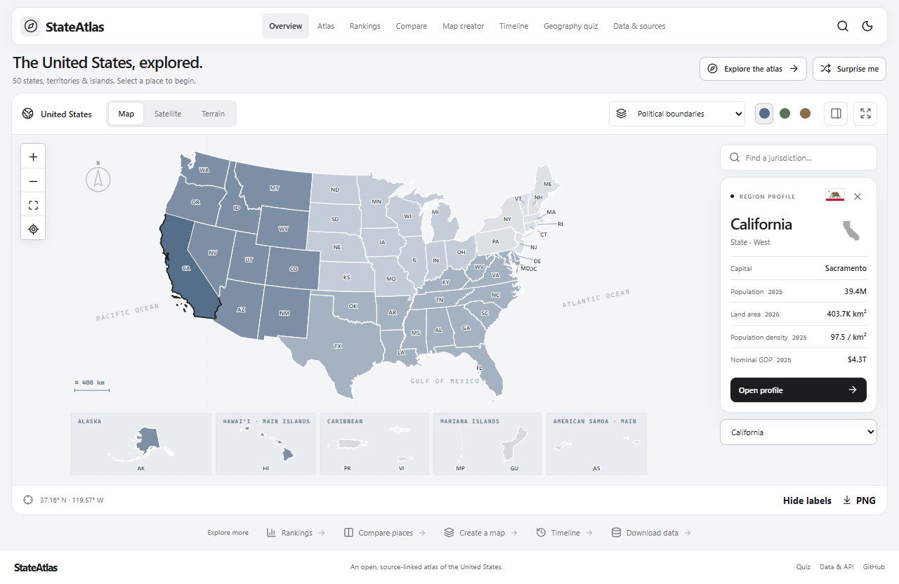

# NorthAtlas

NorthAtlas maps North America’s 23 sovereign countries, 22 additional territories and map units, and 434 first-level subdivisions from Natural Earth 1:10m. The [place directory](/places) connects each entry to a sourced profile. Boundary coverage follows the published dataset and is not an official statement on borders or current administrative divisions.

Open the homepage to explore the continent, or use the map creator to combine any countries and subdivisions, choose preset or custom colors, and export PNG or SVG. The detailed U.S. atlas lives at `/us` and `/map`. Existing U.S. creator links and saved project files still work at `/creator?scope=us`.

Refresh continental boundaries with `node scripts/north-america.mjs` and encyclopedia introductions with `node scripts/north-america-articles.mjs`. Sources and attribution are included on each profile.


**Explore every state. Compare every statistic. Understand America.**

StateAtlas is an interactive atlas and statistical field guide for the 50 states, Washington, D.C., five inhabited territories, and nine U.S. Minor Outlying Islands.



[Mobile screenshot](docs/screenshots/atlas-mobile.png) · [Timeline workspace](docs/screenshots/timeline-desktop.png) · [Social preview artwork](public/social.png)

Use the slim floating navigation to move between tools, or search places and metrics with **Ctrl/Cmd K**. The full-width atlas keeps search and region details inside the map panel, with a compact heading and shortcut row. On smaller screens, the menu beside the wordmark opens all destinations and region details sit below the map within the same panel. A single black-and-white interface uses rounded controls and consistent contrast, independent of system appearance. Map palettes remain available for geographic data.

## Run locally

Install Node.js 24 and pnpm 11. From the repository root, run:

```sh
pnpm install --frozen-lockfile
pnpm dev
```

Open [http://localhost:3000](http://localhost:3000). The app ships with versioned observations and Wikipedia profile excerpts. The core atlas, rankings, and exports work without API keys or a database. Satellite/aerial and terrain views connect to [USGS The National Map](https://www.usgs.gov/faqs/what-are-base-map-services-or-urls-used-national-map) by default, without an API key. Imagery requires an internet connection; dates and resolution vary by location and it is not live imagery. Optional provider overrides are documented in `.env.example`.

The black-and-white interface includes Slate, Sage, and Sand map palettes. Use **Fullscreen** to expand the atlas, **Hide details** for an unobstructed map, and **Escape** to return. Palette shades distinguish Census regions on political maps and fixed statistical bins on thematic maps; territories use a neutral fill. Image exports retain the selected palette.

## Explore

| Route | What you can do |
| --- | --- |
| `/map` | Pan and zoom, select a jurisdiction, switch statistical layers, trace major waterways, and download a PNG. |
| `/regions/california` | Open source-linked region profiles with metrics, an encyclopedia excerpt, and GeoJSON. |
| `/rankings` | Rank 18 metrics by reference year and jurisdiction scope. Switch between table, bar, and map views. |
| `/compare` | Compare two to four jurisdictions and find World Bank economies with similar population, land area, or nominal GDP. |
| `/creator` | Color regions in groups, design a legend, undo edits, save locally, and export SVG, PNG, JSON, or CSV. |
| `/timeline` | Play annual population and GDP series, jump or step between years, and inspect each place’s trend with fixed map thresholds and explicit missing-data states. |
| `/quiz` | Practice silhouettes, locations, capitals, population, and land area. |
| `/data` | Read the API examples, review methodology, and download observations and boundaries. |

## Develop

```sh
pnpm lint
pnpm types
pnpm test
pnpm build
pnpm exec playwright install chromium
pnpm test:e2e
```

Run `pnpm data:build` to reconstruct snapshots from the source cache. See the [data workflow](docs/datasets.md) before refreshing inputs.

- [Architecture](docs/architecture.md)
- [Public API](docs/api.md)
- [Data licensing and attribution](DATA_LICENSES.md)
- [Roadmap](docs/roadmap.md)
- [Contributing](CONTRIBUTING.md)

The software uses the [MIT License](LICENSE). Each dataset has separate reuse terms.

Region profiles include revision-linked Wikipedia chapter excerpts (CC BY-SA 4.0), Wikimedia images with individual credits, and charts drawn from the bundled Census/BEA observations. Encyclopedia context may use different reference years from statistical cards. Run `python scripts/enrich-profiles.py` to update chapter excerpts at the pinned article revisions, then `python scripts/profile-images.py` for credited free images. Images load from Wikimedia and require connectivity; text and statistical charts are bundled. Indicator shares have different denominators and are not a demographic composition. Missing observations are never interpolated.
