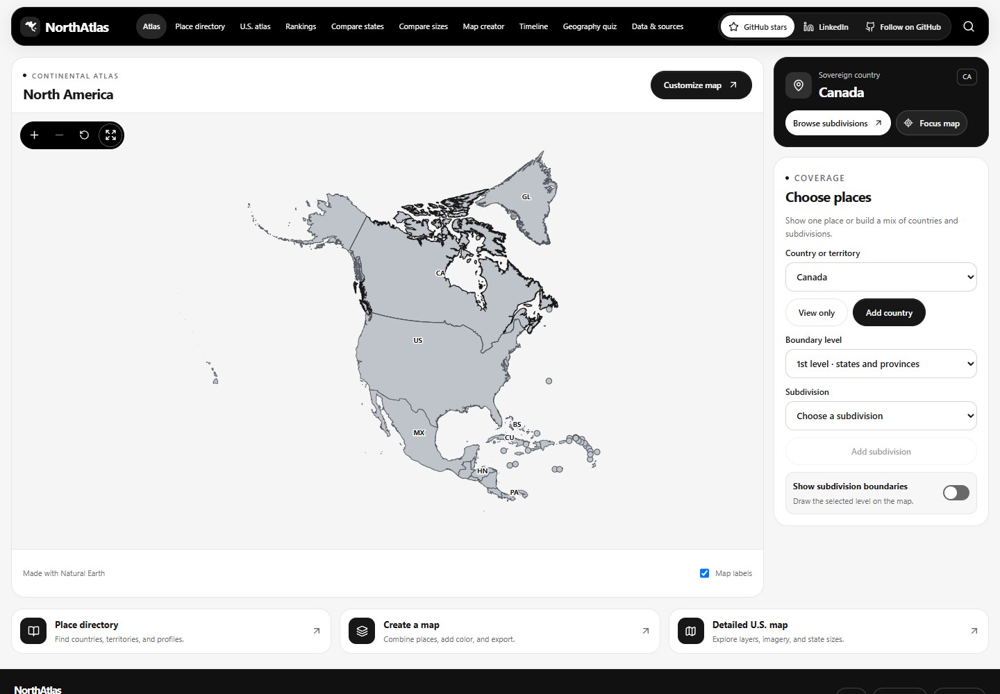
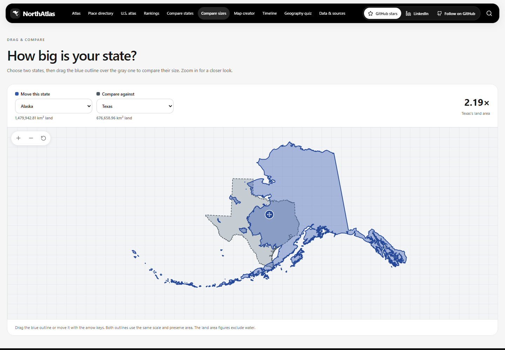
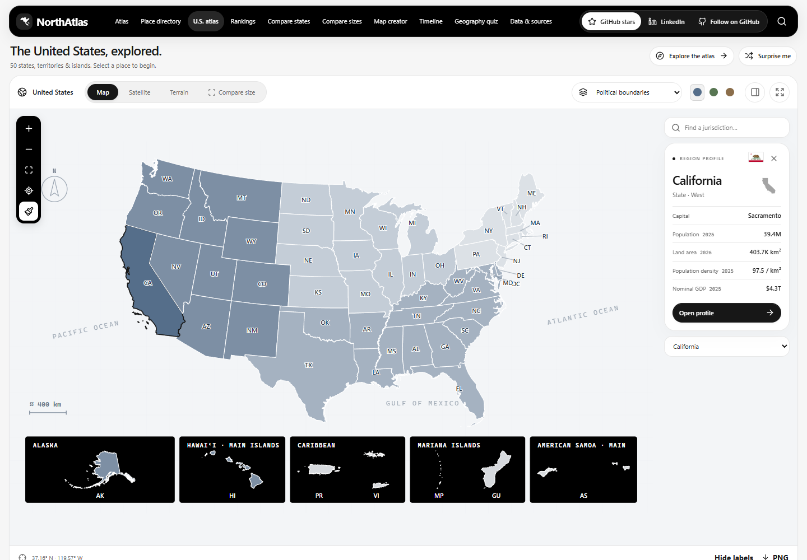
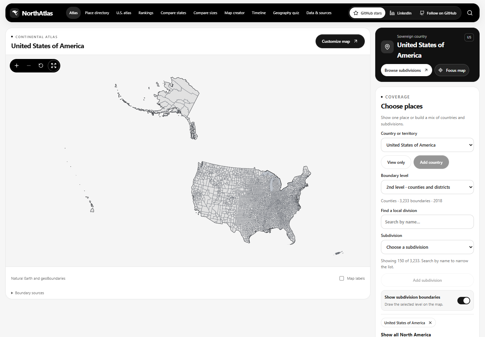
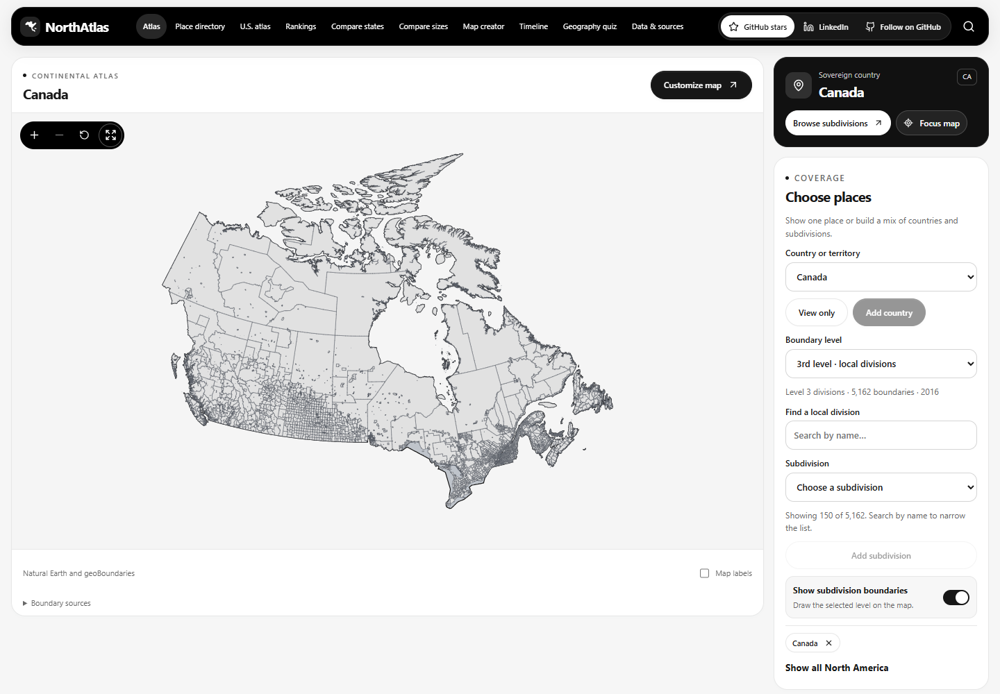
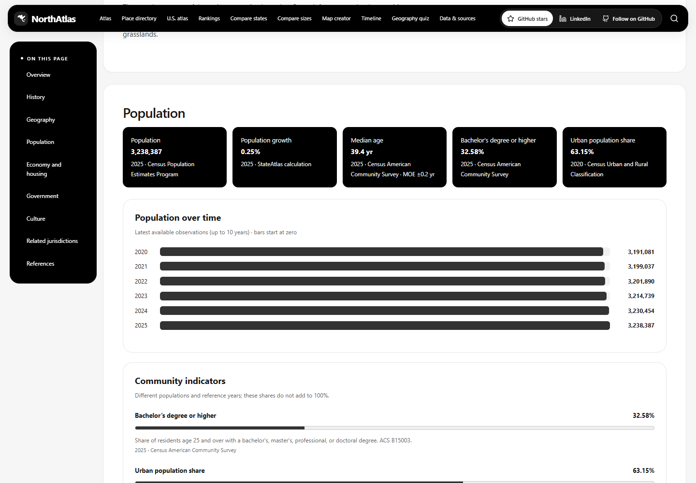
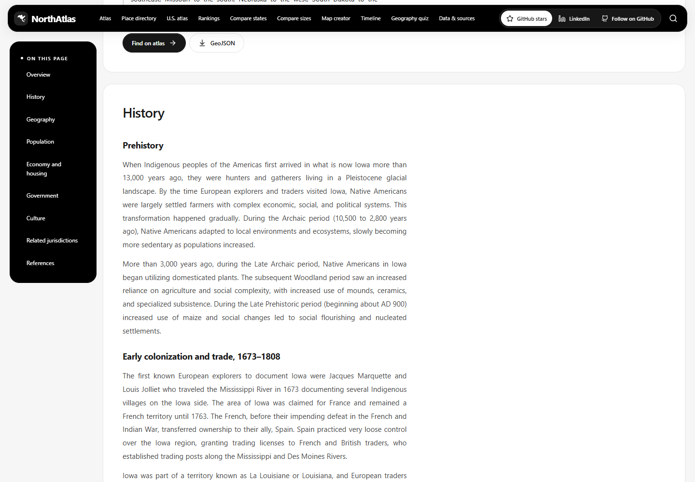
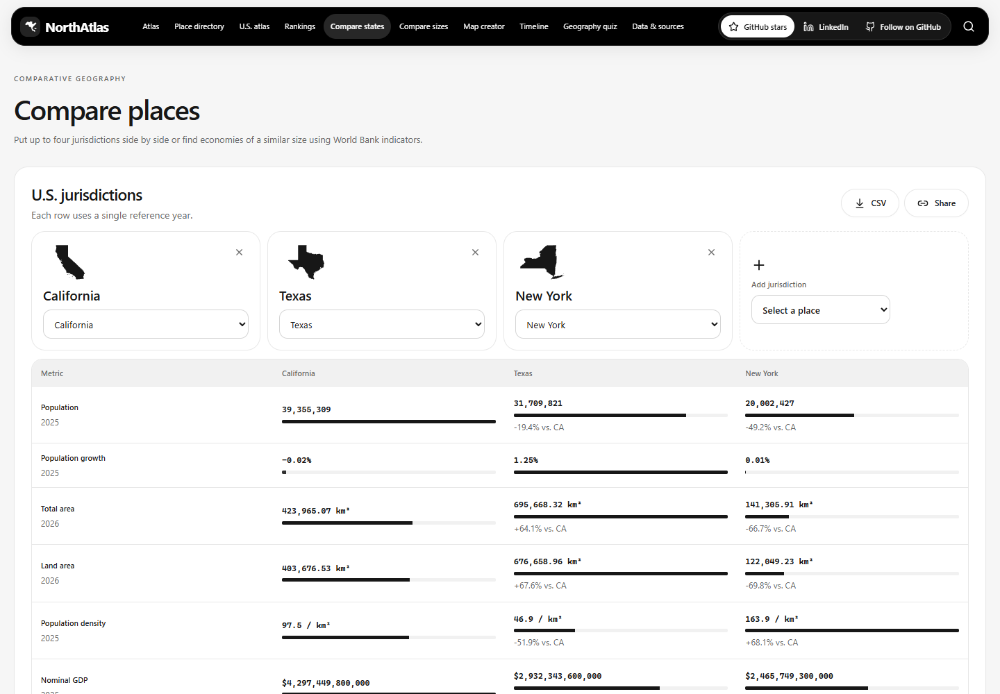
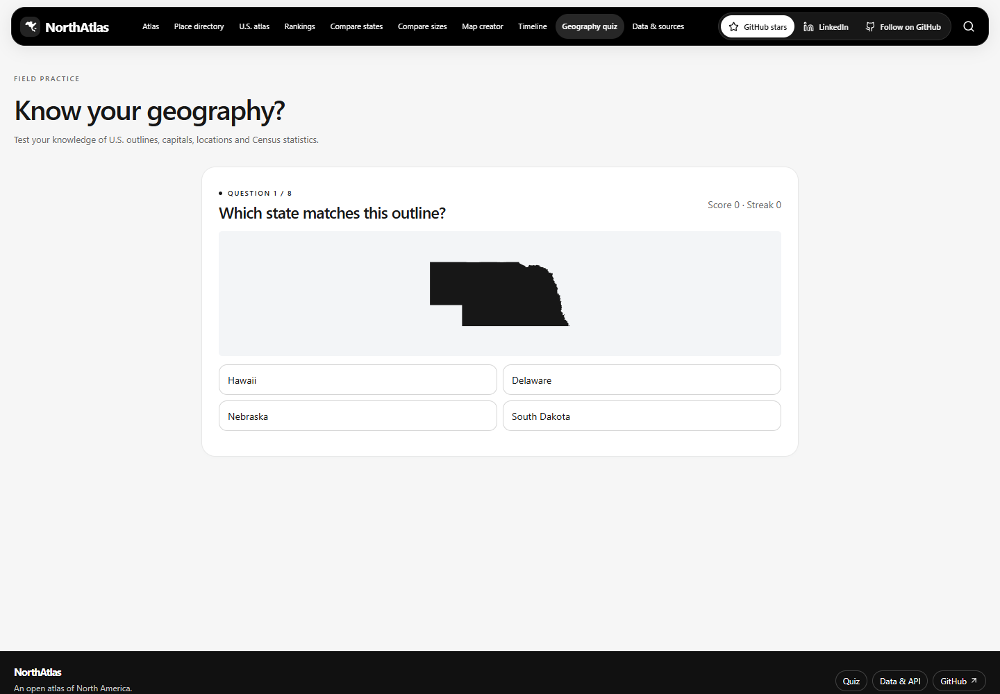
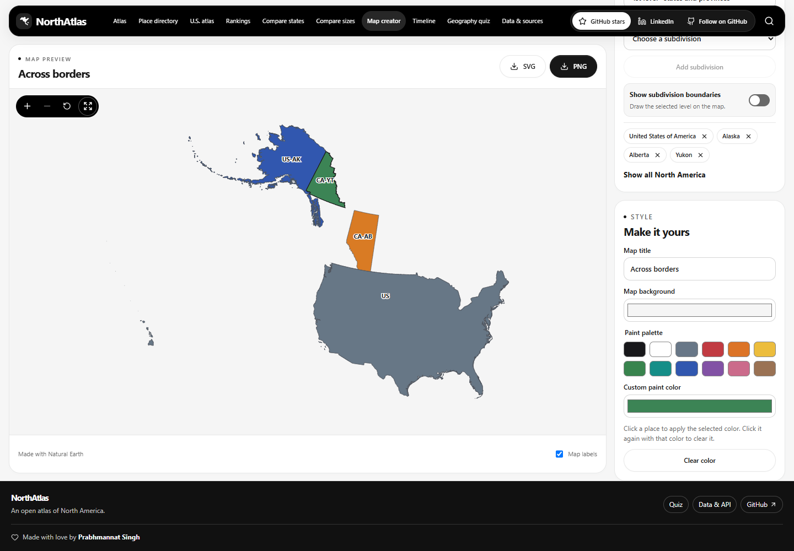

<p align="center">
  
</p>

<h1 align="center">NorthAtlas</h1>

<p align="center"><strong>An interactive atlas and map maker for North America.</strong></p>

<p align="center">
  <a href="https://github.com/PRABHMANNAT/united-states-territories-mapper-geoatlas/stargazers"></a>
  <a href="LICENSE"></a>
  <a href="#run-locally"></a>
</p>

<p align="center"><a href="#feature-tour">Feature tour</a> · <a href="#drag-one-state-over-another">Compare sizes</a> · <a href="#make-your-first-map">Make a map</a> · <a href="#run-locally">Run locally</a> · <a href="#maps-and-data">Explore the data</a></p>

What does Alaska look like over Texas at the same scale? What would a map of the United States, Alberta, and Yukon look like? NorthAtlas lets you explore both ideas in a browser, then export the map you make.



## Feature tour

Explore North America at continental, national, and local scales. Read about a place, compare it with another, make a map, or test what you know.

| Feature | Try it |
| --- | --- |
| **North America + detailed U.S. maps** | Explore countries, territories, states, provinces, and available local divisions. Switch to the U.S. atlas for statistical layers, satellite imagery, terrain, and waterways. |
| **Wikipedia-style place information** | Read sourced chapters, view images, and explore demographics, geography, history, economy, government, and culture in the detailed U.S. profiles. |
| **Drag-and-overlay size comparison** | Move any of the 50 U.S. states over another using area-preserving outlines at one scale. |
| **State statistics comparison** | Compare two to four U.S. jurisdictions with aligned reference years, visual bars, CSV export, and share links. |
| **Map creator** | Combine countries and subdivisions, paint with presets or custom colors, and export PNG or SVG. |
| **Geography quiz** | Play eight-question rounds on outlines, map locations, capitals, land area, population, or Census facts. |

### Drag one state over another

Choose **Compare sizes** in the top navbar to open `/compare-size`. Pick a state in **Move this state**, choose a reference in **Compare against**, and drag the blue outline over the gray one. Zoom both outlines together, reset the view, or use the arrow keys to move the selected outline. On phones, the link is in the navigation menu.

The screenshot shows **Alaska over Texas** after dragging. The outlines use locally centered equal-area projections at a shared scale, so this is an area comparison rather than a comparison of differently scaled atlas insets. The displayed ratio uses **land area**, which excludes water. The same tool is also available through **Compare size** in the detailed U.S. map, including fullscreen mode.



### From the continent to local divisions

Use the homepage to view a single country, all North America, or a custom combination such as **United States + Alberta + Yukon**. Choose a **Boundary level** and turn on **Show subdivision boundaries** to reveal available detail.

| Level | What it shows | Bundled coverage |
| --- | --- | --- |
| **1st level** | States, provinces, territories, and equivalent divisions | 434 first-level subdivisions across the continental dataset |
| **2nd level** | Counties, districts, and equivalents | 17 countries and territories; includes the U.S. county layer |
| **3rd level** | Local divisions, municipalities, and equivalents | Eight countries and territories; Canada is shown below |

**Coverage is source-dependent.** The bundled United States layer stops at level 2; there is no nationwide U.S. level-3 layer. Level names and vintages vary by country. The interface lists the available layers and their sources. Local divisions can be searched, selected, combined, and colored; level-2 and level-3 units do not have encyclopedia profiles.



<details>
<summary><strong>See U.S. county boundaries and a North American level-3 map</strong></summary>

**United States · level 2:** county and county-equivalent boundaries from the bundled 2018 source.



**Canada · level 3:** 5,162 local divisions in the bundled 2016 source. This is an example of North American third-level coverage, not a claim of complete continent-wide coverage.



</details>

### Read the story behind a place

The detailed U.S. profiles offer a **Wikipedia-style reading experience**: chapter navigation, history and geography, population, economy and housing, government, culture, images, related places, and a collapsible references section. Statistical cards identify their source and year; population and community charts make trends easier to read.

North American first-level subdivisions and territories also have sourced profiles through **Place directory**, with content varying by available coverage. Country pages organize their subdivisions. These are independent atlas pages, with Wikipedia excerpts and media credited to their original contributors.



<details>
<summary><strong>See the encyclopedia-style history view</strong></summary>



</details>

### Compare states by the numbers

Choose **Compare states** for population, land area, density, economic indicators, and other available statistics. Add up to four U.S. jurisdictions, inspect differences against the first, download a CSV, or share the comparison. Each metric row uses one reference year and leaves unavailable observations visible as missing. Country comparisons use the bundled World Bank indicators.



### Test your geography

Choose **Geography quiz**, select one of six challenges and a difficulty, and play an eight-question round. Identify a state by silhouette or map location, name capitals, or compare population and land area. Get immediate feedback, track your score and streak, and share your result.



## Make your first map

1. Open **Map Creator** and add a country, territory, or subdivision. You can mix whole countries with individual regions.
2. Pick a swatch or enter a custom color, then click a place to paint it. Click again with the same color to clear its fill.
3. Set a title and background, toggle labels, and download a **PNG** or **SVG**. Use the expand button beside the zoom controls for a fullscreen preview. Press **Esc** to return to the editor.

After starting the app, try the [U.S. + Alaska + Alberta + Yukon map](http://localhost:3000/creator?places=usa,usa-ak,can-ab,can-yt).



## Explore the atlas

| Open | What you can do |
| --- | --- |
| `/` | View the continent, focus on one place, combine places, or show finer boundaries. |
| `/places` | Browse countries and their subdivision directories, or read sourced profiles for territories and first-level subdivisions. |
| `/creator` | Build a custom North American map and export it as PNG or SVG. |
| `/map` | Explore the detailed U.S. atlas with satellite and terrain imagery, statistical layers, waterways, and draggable state outlines for same-scale comparisons. |
| `/rankings` | Rank U.S. jurisdictions by metric and year. |
| `/compare` | Compare two to four U.S. jurisdictions side by side, or find similar economies in World Bank data. |
| `/compare-size` | Drag one of the 50 U.S. state outlines over another at the same scale, with zoom, reset, and keyboard movement. |
| `/timeline` and `/quiz` | Explore changes in population and GDP or practice geography. |
| `/data` | Find downloadable datasets, metric definitions, and API examples. |

Choose **Compare states** for statistics or **Compare sizes** for draggable outlines in the top navbar. On phones, open the navigation menu first. Press **Ctrl/Cmd + K** to find a place or tool. The [U.S. creator](http://localhost:3000/creator?scope=us) supports legends, undo and redo, saved projects, and JSON or CSV export.

## Run locally

Use **Node.js 24** and **pnpm 11**. Clone the repository and run the commands below.

```sh
git clone https://github.com/PRABHMANNAT/united-states-territories-mapper-geoatlas.git
cd united-states-territories-mapper-geoatlas
pnpm install --frozen-lockfile
pnpm dev
```

Open [localhost:3000](http://localhost:3000). The bundled maps, profiles, statistics, and export tools work without a database or API keys. Satellite and terrain imagery need an internet connection and use USGS by default. [USGS The National Map](https://www.usgs.gov/faqs/what-are-base-map-services-or-urls-used-national-map)

Prefer port **5166**? Run `pnpm dev --port 5166` and open [localhost:5166](http://localhost:5166).

## Maps and data

| Coverage | Source |
| --- | --- |
| 23 sovereign countries, 22 territories and other map units, and 434 first-level subdivisions | [Natural Earth](https://www.naturalearthdata.com/downloads/10m-cultural-vectors/10m-admin-1-states-provinces/) |
| Second-level boundaries for 17 countries and territories, and third-level boundaries for eight | [geoBoundaries](https://www.geoboundaries.org/api.html) |
| Detailed U.S. boundaries, population, and economic observations | [U.S. Census Bureau](https://www.census.gov/), [BEA](https://www.bea.gov/), and the [dataset guide](docs/datasets.md) |
| Encyclopedia context and images | Revision links and individual image credits on the relevant profiles |

Local boundary coverage varies by place and year. The atlas lists the source, vintage, and license for each available layer. Country pages act as directories, while deeper subdivisions are available for mapping. The U.S. statistical tools identify missing observations.

The software is [MIT licensed](LICENSE). Data and images have separate reuse terms. [Data licensing and attribution](DATA_LICENSES.md) · [Local boundary layer sources](data/north-america/admin-layers.json) · [Public API](docs/api.md)

NorthAtlas uses Next.js and TypeScript, D3 for vector maps, and MapLibre for U.S. imagery. [Architecture](docs/architecture.md)

## Contribute

Found a missing boundary, mislabeled place, or confusing control? [Open an issue](https://github.com/PRABHMANNAT/united-states-territories-mapper-geoatlas/issues/new) with the place, dataset, or steps to reproduce it. See the [contribution guide](CONTRIBUTING.md) and [data refresh workflow](docs/datasets.md).

```sh
pnpm lint
pnpm types
pnpm test
pnpm build
pnpm exec playwright install chromium
pnpm test:e2e
```

To refresh continental data, run `node scripts/north-america.mjs` for countries and first-level outlines, `node scripts/north-america-admin.mjs` for local boundaries, and `node scripts/north-america-articles.mjs` for encyclopedia introductions.

To refresh the feature screenshots, start the app and run `node scripts/readme-screenshots.mjs`. It captures actual interactions, including dragging Alaska over Texas. Set `ATLAS_SCREENSHOT_URL` for a different local port and optionally `STATEATLAS_E2E_CHANNEL=msedge` to use installed Edge.

Made with love by [Prabhmannat Singh](https://github.com/PRABHMANNAT). If NorthAtlas helps you make a map or discover something new, [give it a star on GitHub](https://github.com/PRABHMANNAT/united-states-territories-mapper-geoatlas).
